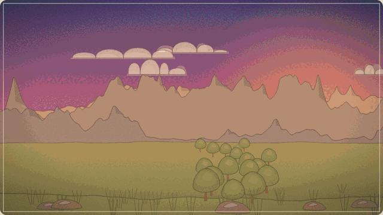
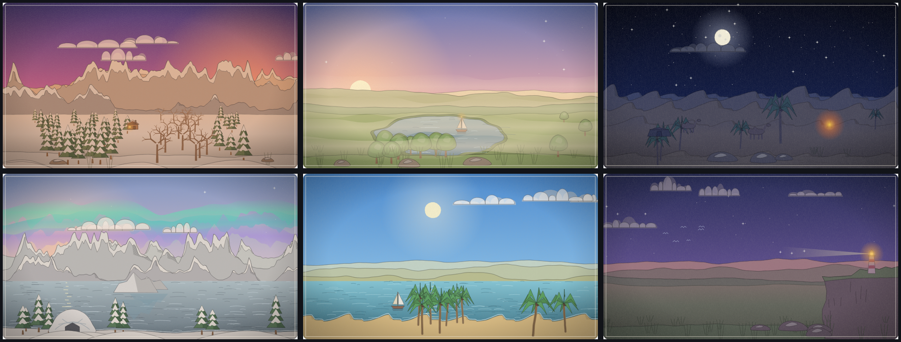

# Landscrawl

Type a sentence. A hand-drawn landscape is drawn live in your browser.



```text
sunset over snowy mountains, a small cabin with a lit window, pine forest
foggy lake at dawn, one boat, no clouds
sahara dunes at night, full moon, a lone palm
```



- **100% client-side.** No backend, no API calls, no AI model, no account, no analytics. It works offline.
- **One file.** `npm run build` produces a single `dist/index.html` (under 100 KB) that also runs from disk.
- **Vector output.** Export SVG or a 2x PNG, in 16:9, 4:3, 1:1 or 9:16.
- **Shareable without a server.** The sentence, seed and shape live in the URL hash (`#s=…&t=…&l=en&r=16:9`), which browsers never send anywhere.
- **Honest.** Words it does not understand are listed ("I didn't know: …"); nothing is silently ignored.
- **Original art.** Code is MIT, the drawings are CC0 ([LICENSE](LICENSE), [LICENSE-ASSETS](LICENSE-ASSETS)).

## Try it

```bash
npm install
npm run dev        # http://localhost:5173
npm test           # the whole suite, no browser needed
npm run build      # dist/index.html, one self-contained file
```

Node 20+ (22 recommended, see `.nvmrc`). There are no runtime dependencies: Vite, TypeScript, Vitest and `vite-plugin-singlefile` are dev tools only.

## What you can say

Landscapes are built from plain words, and later words win ("day … night" is night). It understands:

| Kind | Examples |
| --- | --- |
| Time | dawn, sunrise, noon, golden hour, dusk, twilight, night, midnight |
| Sky | full moon, crescent moon, stars, milky way, aurora, northern lights, sunny, overcast |
| Weather | rain, drizzle, downpour, storm, snow, blizzard, fog, mist, haze, wind, gale, calm |
| Land | mountains, hills, dunes, plains, valley, cliffs, canyon, mesa, volcano, tundra, glacier, savanna, swamp, beach, island |
| Water | sea, lake, river, waterfall, iceberg, pond, fjord, bay |
| Plants | forest, pine, palm, cactus, flowers, grass, dead trees, "a lone tree" |
| Things | cabin, house, village, boat, road, bridge, lighthouse, tent, campfire, windmill, birds, castle, casbah, mosque, camel, igloo, pyramid, ruins, sled, penguins, whale |
| Moods | cozy, lonely, grand, spooky |
| Scenes | sahara, desert, arctic, antarctica, tropical, haunted, alpine, oasis, coast, jungle, fjord, highlands, countryside, mediterranean, hoggar, kabylie |

And how you say it:

- **Plurals and typos:** `mountians` still draws mountains (one slip is forgiven in words of 5+ letters).
- **Negation:** `no clouds`, `without snow or wind` remove things, even ones mentioned earlier.
- **Intensity and size:** `heavy rain`, `light fog`, `a few clouds`, `tiny village`, `huge sun`, `two boats`, `a lone palm`.
- **Colours:** `red sky`, `purple mountains`, `green water` paint the nearest noun.
- **Anything you leave out** is filled in from the seed, so the picture stays stable while you type and changes with **Re-roll**.

## How it works

```
text ──parse()──▶ SceneState ──buildScene()──▶ Layer[] ──render()──▶ SVG
        pure          pure + seed                 pure / DOM stage
```

The parser is rule-based (no ML), the scene builder is a set of pure functions fed by a seeded PRNG (mulberry32), and the renderer turns each path into a short-segment wobbly line, with a double-line outline and hatching. The live stage cycles four jitter variants at about 7 fps so lines tremble, settles 600 ms after you stop typing, draws new elements in, and shifts layers when you drag for a little parallax. `prefers-reduced-motion` turns the boil, draw-in and parallax easing off.

More in [docs/ARCHITECTURE.md](docs/ARCHITECTURE.md). To add a word or a language, see [docs/CONTRIBUTING.md](docs/CONTRIBUTING.md).

## Known limits

- It draws a landscape, not a specific place: `sahara` gives dunes, sun and warm colours, not a map of the Sahara.
- Typo tolerance can over-reach on short words (`horse` can read as `house`). Edit-distance 1 is a trade-off.
- Colours go in front of the noun (`red sky`, not `sky red`).
- A `bridge` needs water to span; without any it is left out and nothing is drawn.
- English only for now. Adding a language is one lexicon file plus UI strings.

## Credits

Landscrawl grew out of an earlier open-source prototype, Describble (MIT). The original copyright notice is kept in [LICENSE](LICENSE). All drawing code here is new.
